<div align="center">

# Bandha

**Track your personal finances and your whole net worth in one tidy ledger: bank accounts, cash, crypto, gold, and debts.**

Web · Android · iOS &nbsp;|&nbsp; Indonesian & English &nbsp;|&nbsp; Light & dark

[Bahasa Indonesia](README.md) · [Features](#features) · [Screenshots](#screenshots) · [Quick start](#quick-start) · [Deploy](docs/DEPLOY.md)

<br>

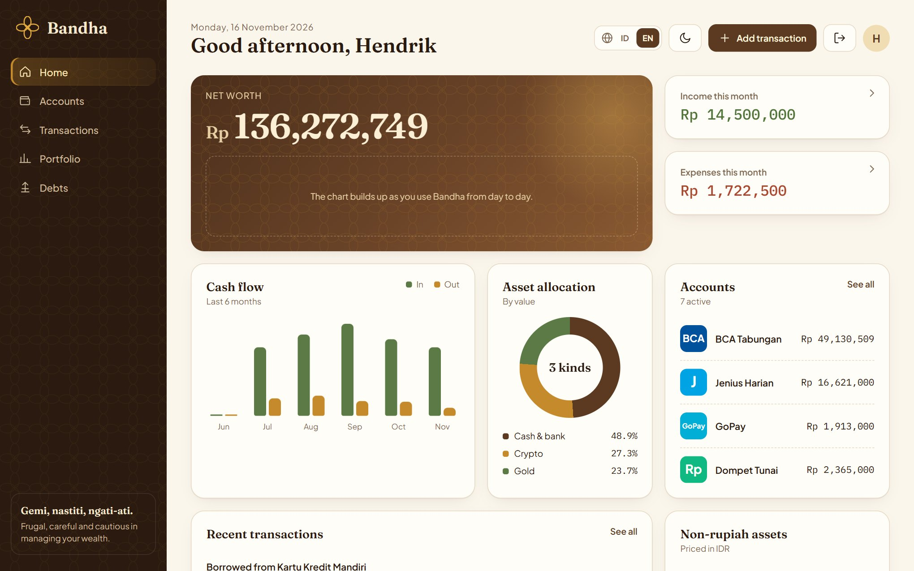

</div>

> *Bandha* (Javanese): one's belongings and wealth. Bandha is a **bookkeeping and tracking tool, not a trading platform**: it never buys or sells anything for you.

## Features

- **True net worth.** Every account (bank, e-wallet, cash, crypto exchange, wallet, gold) and every debt rolled into one number, with allocation and history.
- **Multi-asset portfolio.** Crypto, gold, foreign currency, and Indonesian and US stocks with market prices. Buys and sells use **weighted-average cost**, so unrealised and **realised** gains are both visible.
- **Cash flow.** Income and spending by category and month, kept separate from investment gains.
- **Debts & receivables.** Instalments, credit cards, and loans to friends; partial payments, due dates, and a remaining balance that computes itself.
- **Complete transactions.** Income, expense, transfers (with fees), buy, sell, edit, and void, all with an audit trail.
- **CSV bank-statement import.** Paste or upload, review row by row before saving (all-or-nothing), and undo a whole import if it was wrong.
- **Guided start.** A first-run checklist that adapts to your data.
- **Bilingual, two themes.** Indonesian and English on web and mobile; light and dark in the *Batik Sogan* palette.
- **Secure accounts.** Sign-up confirmed with a 6-digit emailed code, or one-click sign-in/sign-up with Google ([setup guide](docs/GOOGLE-LOGIN.md), Indonesian), password reset by email ([SMTP guide](docs/EMAIL.md), Indonesian); tokens live in `httpOnly` cookies (web) and SecureStore (mobile).
- **Move from FinMap.** A one-person-per-run migration script with dry-run and balance reconciliation ([guide](docs/MIGRASI-FINMAP.md), Indonesian).

## Screenshots

### Web

<table>
  <tr>
    <td width="50%">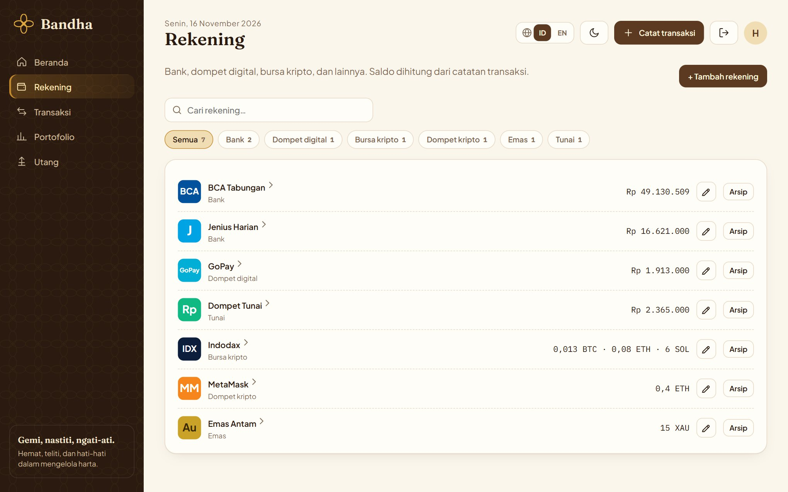<br><sub><b>Accounts</b>: banks, e-wallets, cash, exchanges, wallets, gold</sub></td>
    <td width="50%">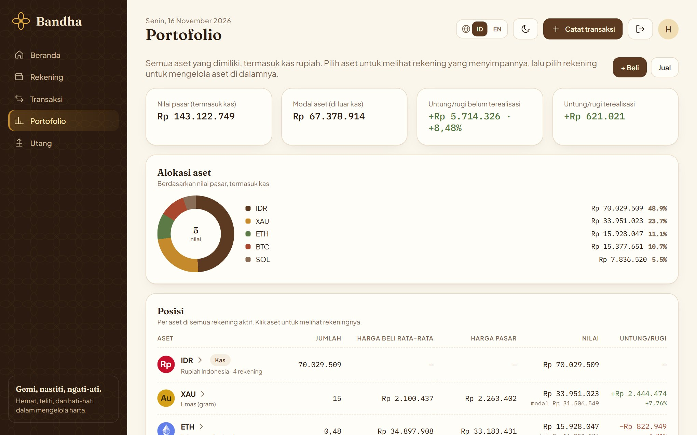<br><sub><b>Portfolio</b>: average cost and gain/loss per asset</sub></td>
  </tr>
  <tr>
    <td>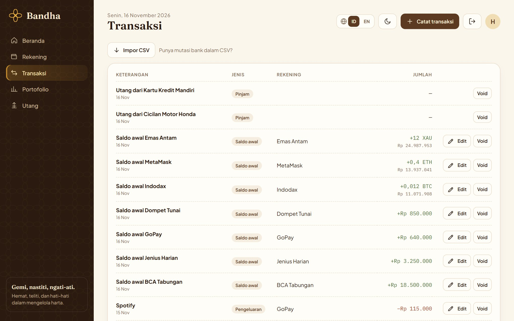<br><sub><b>Transactions</b>: search, filter, edit, void</sub></td>
    <td>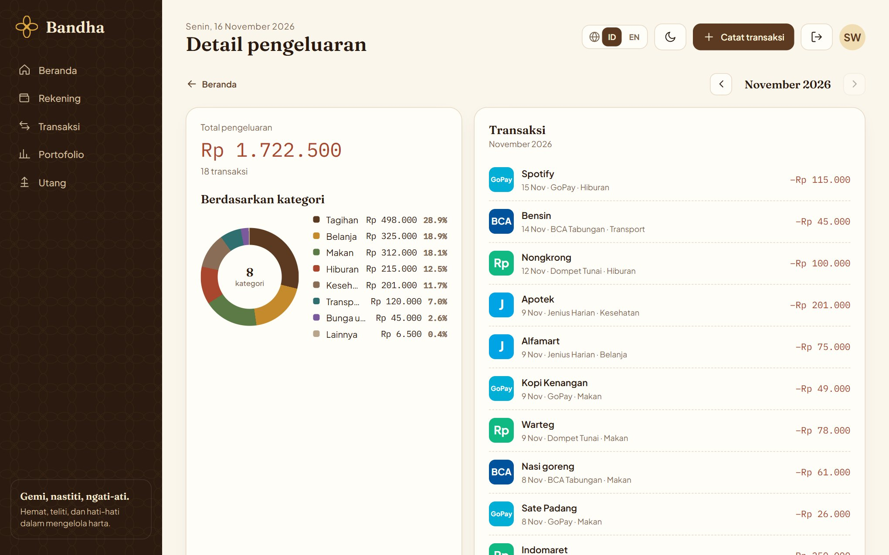<br><sub><b>Cash flow</b>: where your money goes</sub></td>
  </tr>
  <tr>
    <td>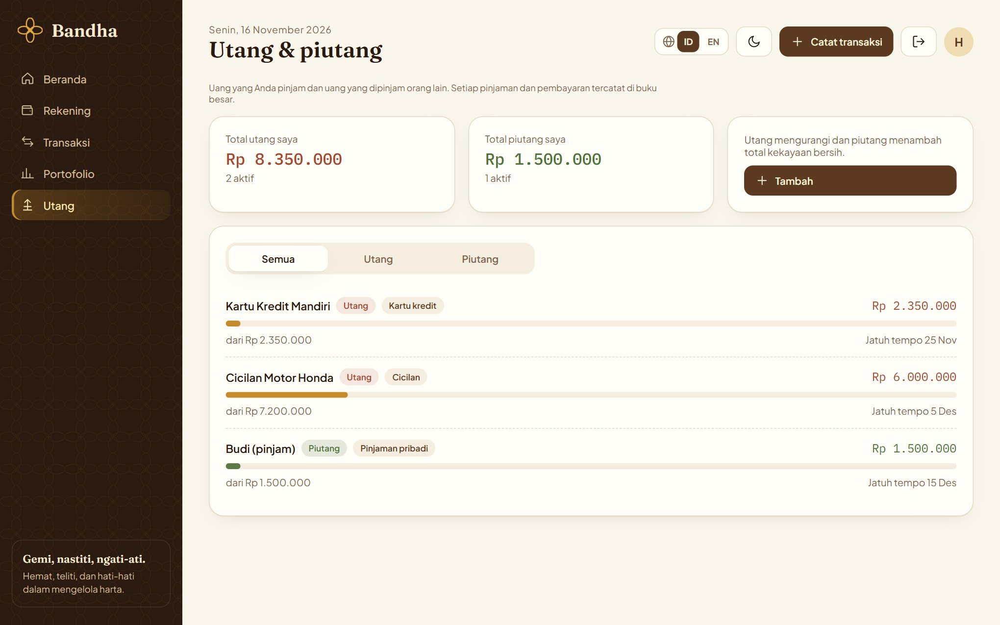<br><sub><b>Debts & receivables</b></sub></td>
    <td>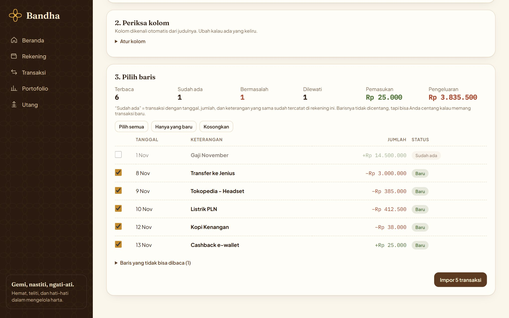<br><sub><b>CSV import</b>: review before saving</sub></td>
  </tr>
</table>

### Dark theme

<table>
  <tr>
    <td width="50%">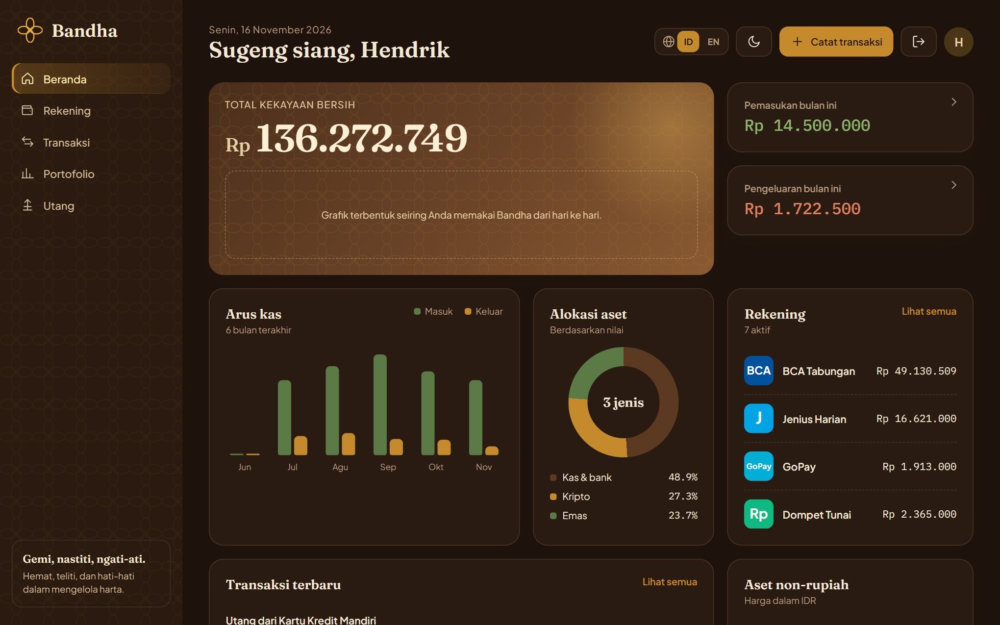</td>
    <td width="50%">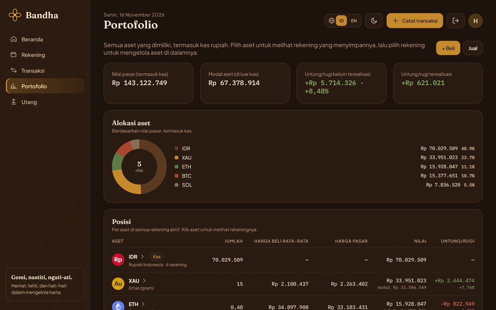</td>
  </tr>
</table>

### Mobile (Android and iOS)

<table>
  <tr>
    <td align="center">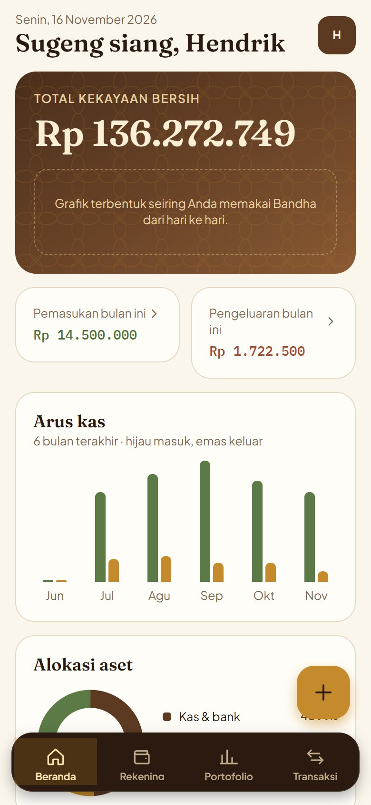</td>
    <td align="center">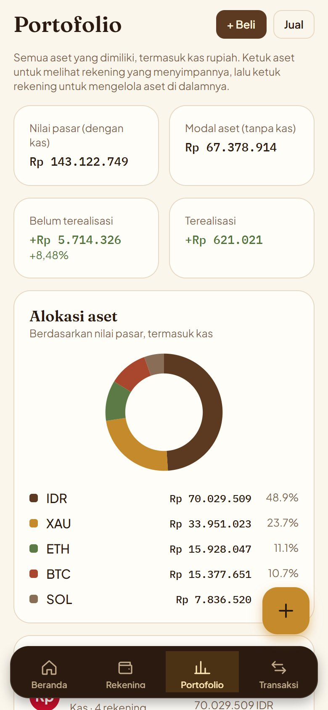</td>
    <td align="center">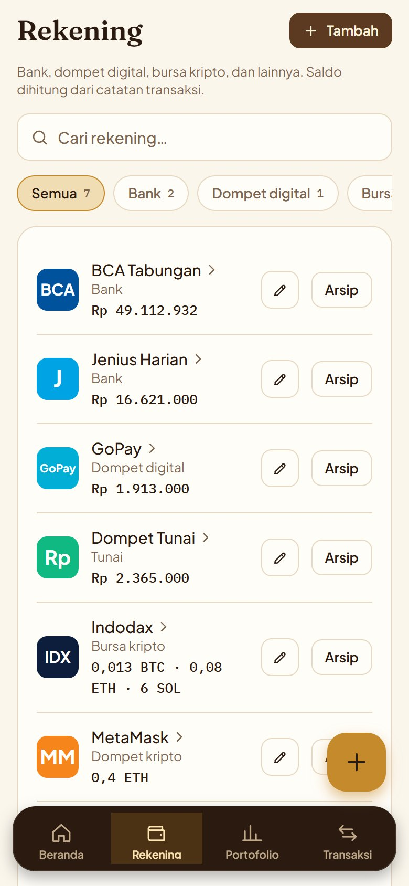</td>
    <td align="center">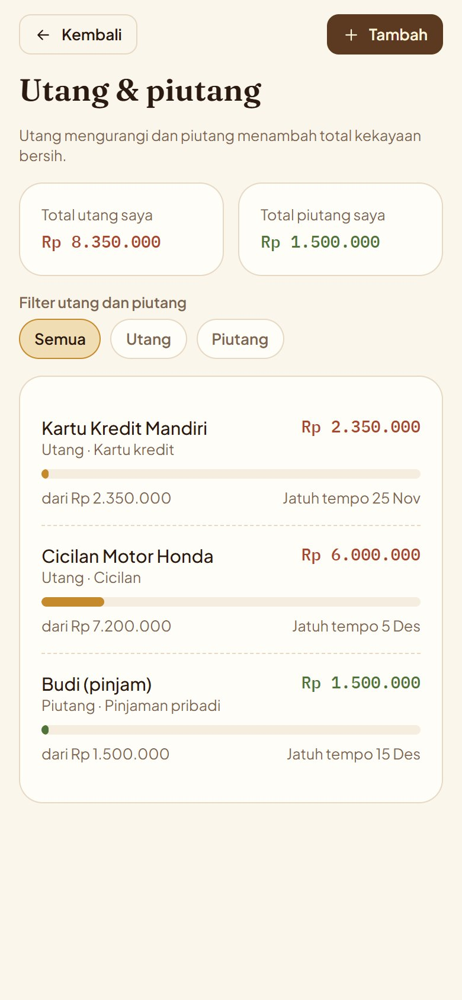</td>
    <td align="center">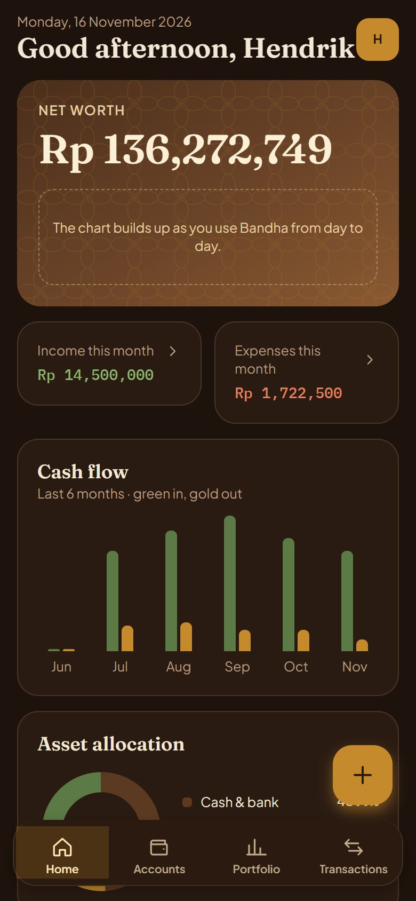</td>
  </tr>
</table>

> All screenshots use **fictional demo data**. Mobile screenshots come from the Expo web preview.

## Accounting principles

Bandha is double-entry, so every number can be traced and cannot silently change.

- The ledger is the source of truth. Entries are never modified; balances are derived.
- Journals always balance in the functional currency (IDR). No zero-value entries.
- "Delete" means void through a reversing journal; edit means reversal plus replacement. The audit trail stays intact.
- Money is never a float; amounts are decimals (strings/`numeric`).
- A transfer is not income or expense, and it moves cost basis proportionally.
- Unknown cost basis stays `null`; it is never silently zero.
- Prices are keyed by (asset, quote currency), so a USD quote can never overwrite an IDR one.
- Data scope always comes from the verified token, never from a client-supplied ID.

Per-feature notes: [docs/FITUR-TEKNIS.md](docs/FITUR-TEKNIS.md) (Indonesian).

## Tech stack

| Layer | Technology |
| --- | --- |
| Monorepo | pnpm workspaces, TypeScript throughout |
| API | Hono, JWT (jose) with refresh-token rotation, argon2 |
| Database | PostgreSQL 16 + Drizzle ORM |
| Web | Next.js 16 (App Router), React 19, SWR; BFF with `httpOnly` cookie tokens |
| Mobile | Expo SDK 58, React Native 0.88, Expo Router; tokens in SecureStore |
| Validation | Zod, shared by clients and API |
| Testing | Vitest (unit, plus integration against real PostgreSQL) |
| Deploy | Docker Compose, nginx, GitHub Actions |

## Repository layout

```
apps/api              REST API (Hono)
apps/web              Web (Next.js)
apps/mobile           Android + iOS (Expo)
packages/ledger       Pure accounting core: journals, voids, average cost
packages/db           Drizzle schema and migrations
packages/validation   Shared Zod schemas
packages/api-client   HTTP client, types, number formatting, logo catalogue
deploy/               Dockerfiles, Compose, deploy/backup/restore scripts, nginx
docs/                 Deploy guide, technical notes, FinMap migration
design/dashboard      "Batik Sogan" design mockup
```

## Quick start

Requires **Node 22+**, **pnpm 12**, and **Docker** (only to run a local PostgreSQL; you can use your own instead).

```bash
pnpm install
cp .env.example .env
pnpm db:up          # PostgreSQL via Docker (port 5434)
pnpm db:migrate
pnpm db:seed        # asset catalogue (crypto, gold, currencies)
pnpm dev:api        # http://localhost:4000/api/health
pnpm dev:web        # http://localhost:3000
pnpm dev:mobile     # Expo: scan the QR with Expo Go, or press a / i
```

Open http://localhost:3000, sign up, and follow the **Quick start** checklist on the dashboard. For offline development set `MARKET_PROVIDER=fake`.

**Admin:** sign up and verify the account first, then make it an admin from the command line (`pnpm db:make-admin you@example.com` on a dev machine, add `--revoke` to remove it; on the server use `docker compose ... run --rm migrate pnpm --filter @bandha/db run make-admin you@example.com`, see docs/DEPLOY.md section G). An **Admin** menu (statistics, user list with disable/enable, audit log) then appears for that account.

| Command | What it does |
| --- | --- |
| `pnpm typecheck` | Type-check every package |
| `pnpm test` | Unit tests (192) |
| `pnpm test:integration` | Integration tests (120, need PostgreSQL) |
| `pnpm db:generate` | Generate a migration from schema changes |

## Deploy

Two environments from two branches (`development`, `main`), each its own Docker Compose stack (database, automatic migration, API, web). `deploy/deploy.sh` pulls, builds, waits until everything is healthy, and **automatically restores the previous version** if the new one fails. CI/CD runs on GitHub Actions. Full guide: **[docs/DEPLOY.md](docs/DEPLOY.md)** (Indonesian).

## Limitations

- Foreign currencies are limited to the 30 ECB currencies; debts are IDR only with no automatic instalment schedule. Asset-for-asset buy/sell (e.g. BTC with USDT) is available on the web and in the mobile app.
- The mobile app is not yet packaged as an APK/IPA; it currently runs through Expo.

## License

Not yet decided. Until a license is added, all rights are reserved by the repository owner.
