<div align="center">

# Bandha

**Catat keuangan pribadi dan pantau seluruh kekayaan Anda dalam satu buku besar yang rapi: rekening, uang tunai, kripto, emas, sampai utang.**

Web · Android · iOS &nbsp;|&nbsp; Indonesia & English &nbsp;|&nbsp; Terang & gelap

[English](README.en.md) · [Fitur](#fitur) · [Tampilan](#tampilan) · [Mulai](#mulai-cepat) · [Deploy](docs/DEPLOY.md)

<br>

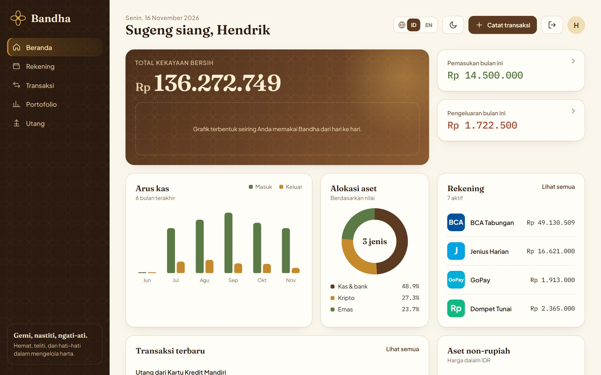

</div>

> *Bandha* (Jawa): harta benda. Bandha adalah pencatat dan pelacak, **bukan platform trading**: tidak ada jual-beli sungguhan, hanya pencatatan milik Anda.

## Fitur

- **Kekayaan bersih sejati.** Semua rekening (bank, e-wallet, tunai, bursa kripto, dompet, emas) dan utang dihitung jadi satu angka, lengkap dengan alokasi aset dan riwayatnya.
- **Portofolio multi-aset.** Kripto, emas, valas, serta saham Indonesia dan AS dengan harga pasar. Beli dan jual dicatat dengan **modal rata-rata tertimbang**, sehingga untung/rugi belum terealisasi dan **terealisasi** terlihat jelas.
- **Arus kas.** Pemasukan dan pengeluaran per kategori, per bulan, terpisah dari untung/rugi investasi.
- **Utang & piutang.** Cicilan, kartu kredit, dan pinjaman antarteman; bayar sebagian, pantau jatuh tempo, dan sisa otomatis menghitung dirinya sendiri.
- **Transaksi lengkap.** Pemasukan, pengeluaran, transfer antarrekening (termasuk biaya), beli, jual, edit, dan batalkan, semuanya dengan jejak audit.
- **Impor CSV mutasi bank.** Tempel atau unggah CSV, tinjau baris demi baris sebelum disimpan (semua-atau-tidak-sama-sekali), dan batalkan seluruh impor bila salah.
- **Mulai cepat.** Panduan awal yang menyesuaikan dengan data Anda: tambah rekening, saldo awal, transaksi pertama.
- **Dwibahasa dan dua tema.** Indonesia dan English di web dan mobile; tema terang dan gelap bergaya *Batik Sogan*.
- **Akun yang aman.** Pendaftaran dikonfirmasi dengan kode 6 angka lewat email, lupa kata sandi lewat email ([panduan SMTP](docs/EMAIL.md)), token disimpan di cookie `httpOnly` (web) dan SecureStore (mobile).
- **Pindah dari FinMap.** Skrip migrasi satu-orang-per-jalan dengan dry-run dan rekonsiliasi saldo ([panduan](docs/MIGRASI-FINMAP.md)).

## Tampilan

### Web

<table>
  <tr>
    <td width="50%">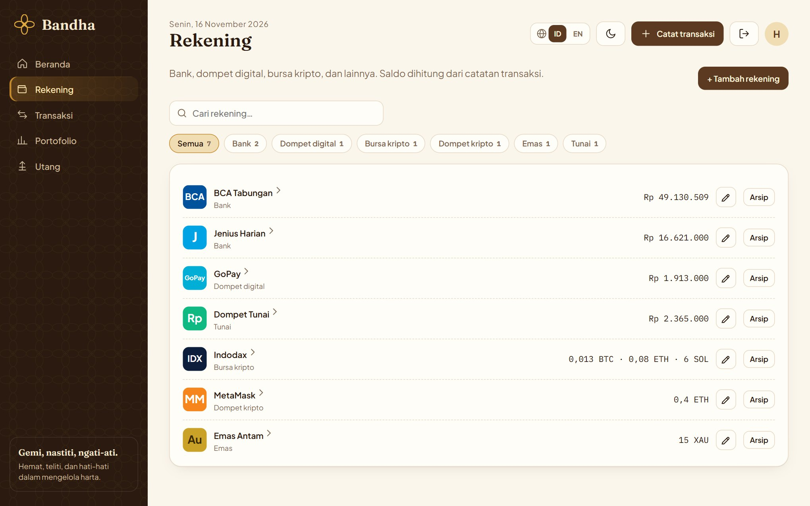<br><sub><b>Rekening</b>: bank, e-wallet, tunai, bursa, dompet, emas</sub></td>
    <td width="50%">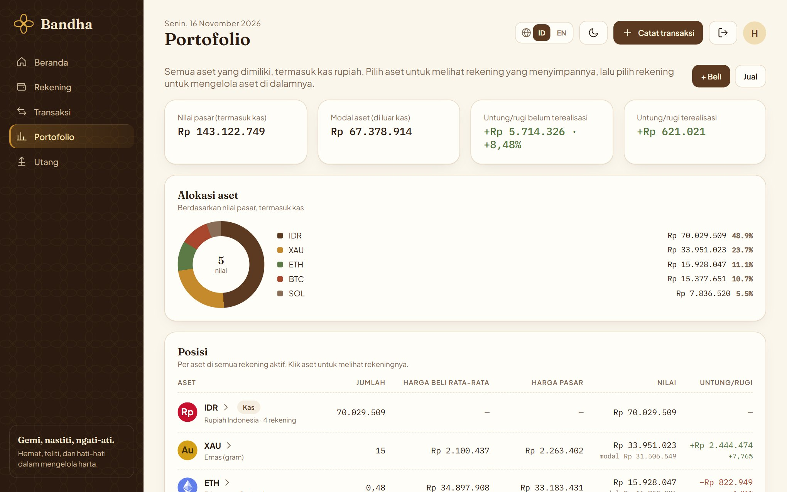<br><sub><b>Portofolio</b>: modal rata-rata dan untung/rugi per aset</sub></td>
  </tr>
  <tr>
    <td>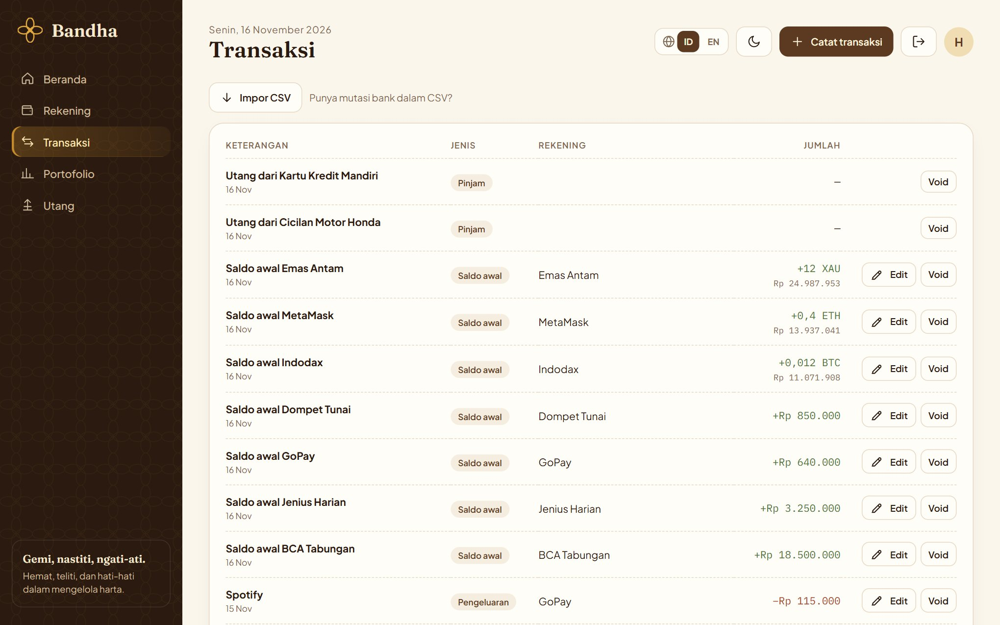<br><sub><b>Transaksi</b>: cari, saring, edit, dan batalkan</sub></td>
    <td>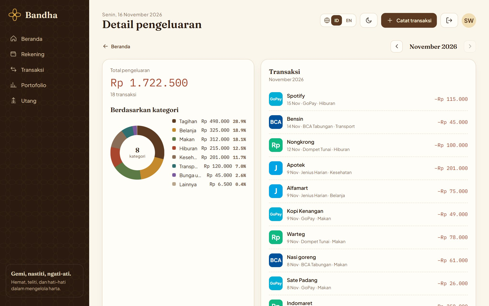<br><sub><b>Arus kas</b>: ke mana uang Anda pergi</sub></td>
  </tr>
  <tr>
    <td>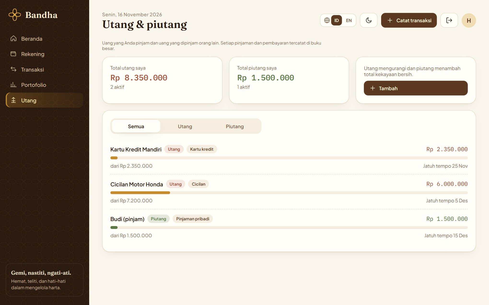<br><sub><b>Utang & piutang</b>: sisa dan jatuh tempo</sub></td>
    <td>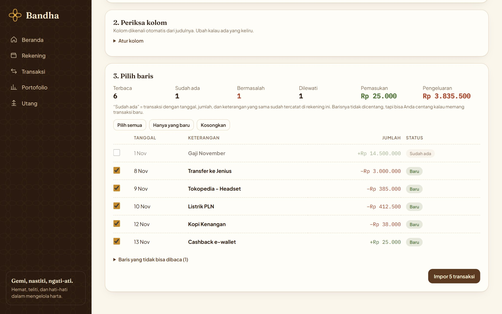<br><sub><b>Impor CSV</b>: tinjau dulu, baru simpan</sub></td>
  </tr>
  <tr>
    <td>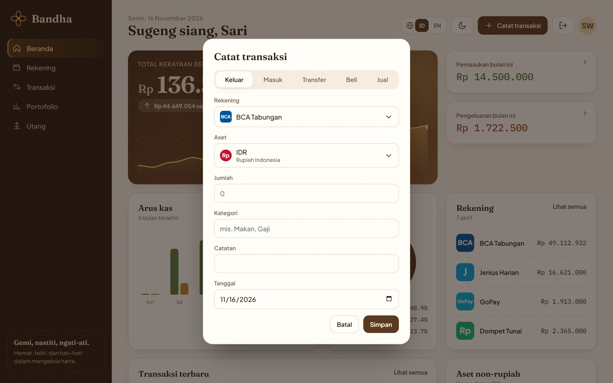<br><sub><b>Catat transaksi</b> yang ringkas</sub></td>
    <td>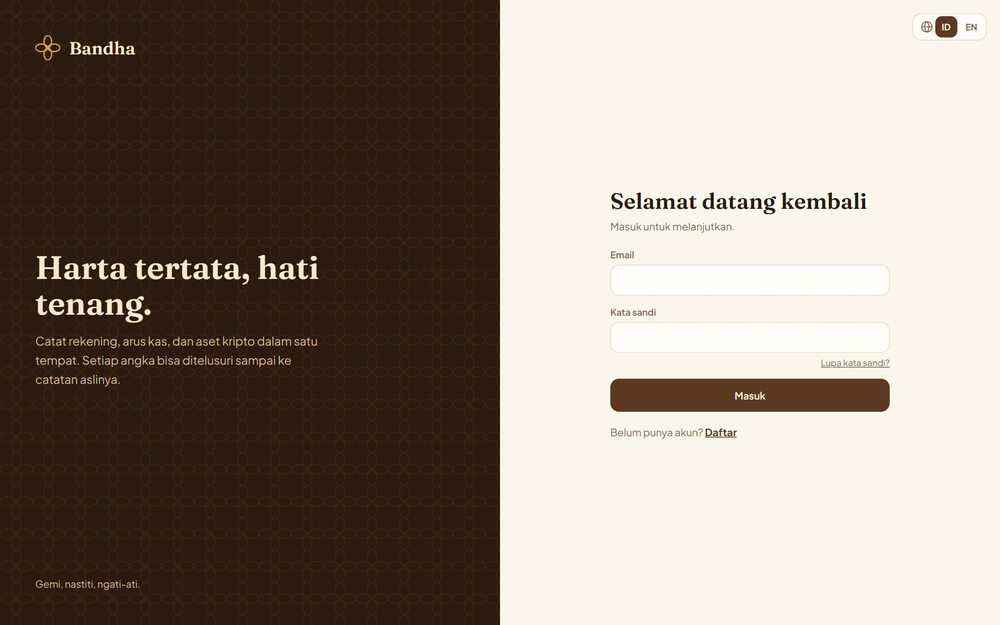<br><sub><b>Masuk</b></sub></td>
  </tr>
</table>

### Tema gelap dan bahasa Inggris

<table>
  <tr>
    <td width="50%">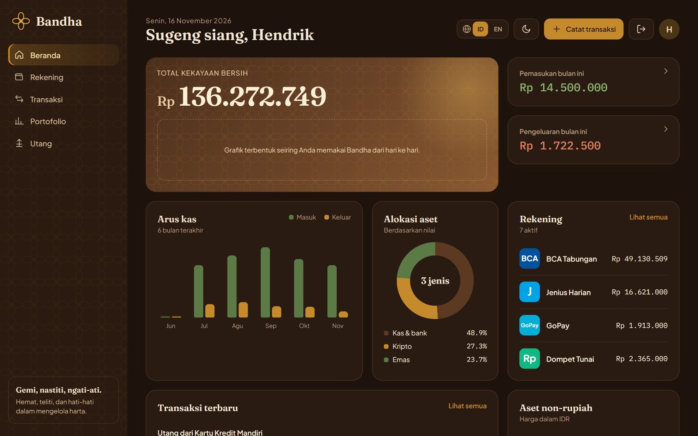<br><sub>Beranda, tema gelap</sub></td>
    <td width="50%">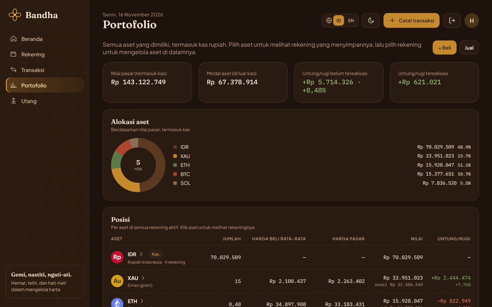<br><sub>Portofolio, tema gelap</sub></td>
  </tr>
  <tr>
    <td colspan="2" align="center">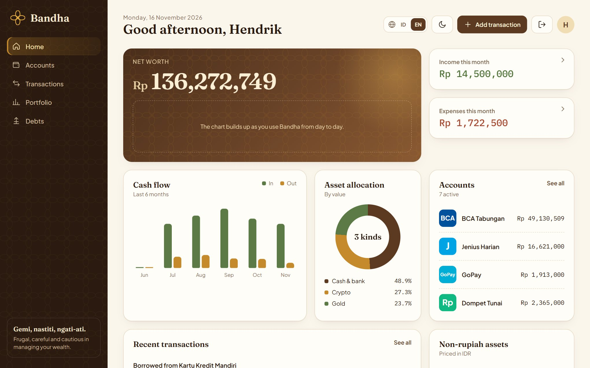<br><sub>Antarmuka berbahasa Inggris</sub></td>
  </tr>
</table>

### Mobile (Android dan iOS)

<table>
  <tr>
    <td align="center">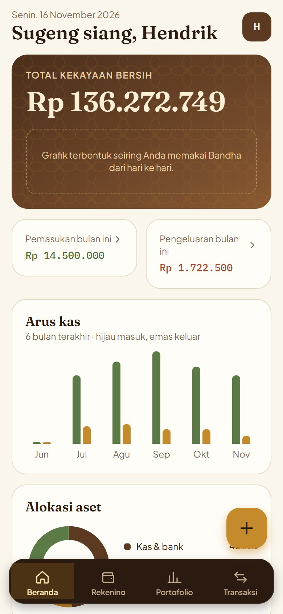<br><sub>Beranda</sub></td>
    <td align="center">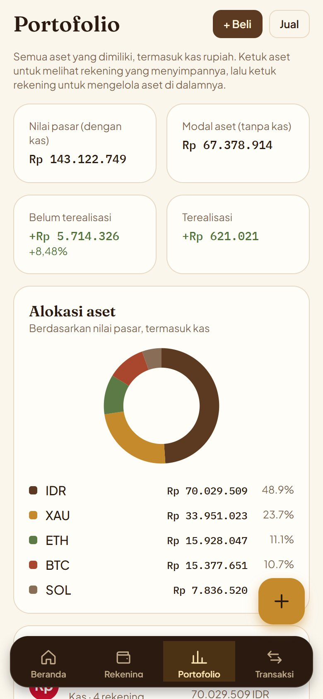<br><sub>Portofolio</sub></td>
    <td align="center">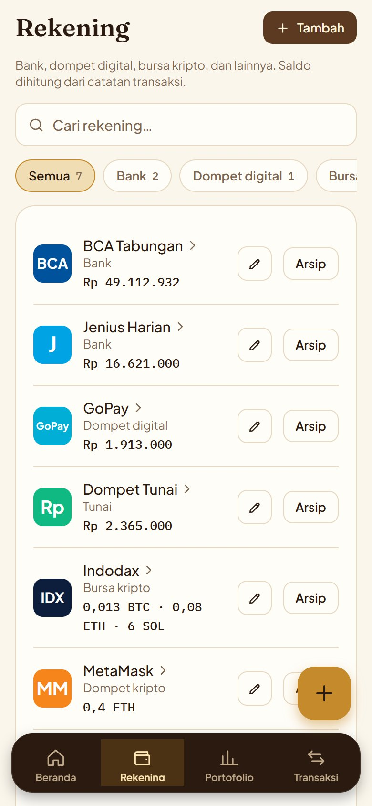<br><sub>Rekening</sub></td>
    <td align="center">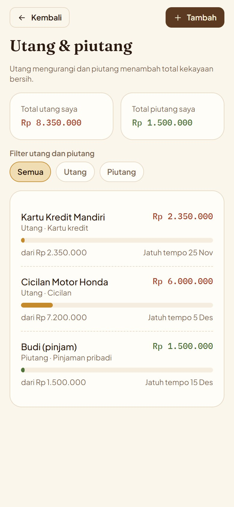<br><sub>Utang & piutang</sub></td>
    <td align="center">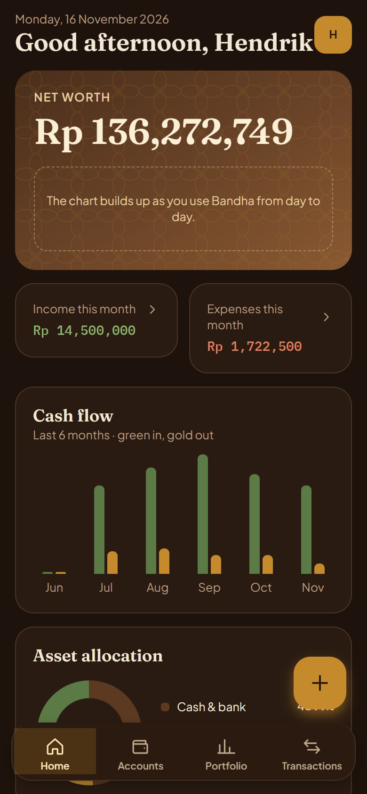<br><sub>Gelap + English</sub></td>
  </tr>
</table>

> Semua tangkapan layar memakai **data fiktif** (pengguna demo "Hendrik"); tidak ada data nyata di dalamnya. Tangkapan layar mobile diambil dari pratinjau Expo web.

## Prinsip akuntansi

Bandha memakai pembukuan berpasangan (*double-entry*), sehingga angka yang tampil selalu bisa ditelusuri dan tidak bisa "diam-diam" berubah.

- **Buku besar adalah sumber kebenaran.** Entri tidak pernah diubah; saldo diturunkan dari entri.
- **Jurnal selalu seimbang** dalam mata uang fungsional (IDR). Tidak ada entri bernilai nol.
- **"Hapus" = batalkan lewat jurnal pembalik.** Edit = pembalik + pengganti. Jejak audit selalu utuh.
- **Uang bukan float.** Semua nominal berupa desimal (string/`numeric`).
- **Transfer bukan pemasukan atau pengeluaran**, dan memindahkan modal secara proporsional.
- **Modal tidak diketahui tetap `null`**, tidak pernah diam-diam jadi 0.
- **Harga dikunci per (aset, mata uang kuotasi)**, jadi kuotasi USD tidak bisa menimpa IDR.
- **Cakupan data selalu dari token terverifikasi**, bukan dari ID yang dikirim klien.

Rincian per fitur ada di [docs/FITUR-TEKNIS.md](docs/FITUR-TEKNIS.md).

## Teknologi

| Lapisan | Teknologi |
| --- | --- |
| Monorepo | pnpm workspaces, TypeScript penuh |
| API | Hono, JWT (jose) dengan rotasi refresh-token, argon2 |
| Database | PostgreSQL 16 + Drizzle ORM |
| Web | Next.js 16 (App Router), React 19, SWR; BFF dengan token di cookie `httpOnly` |
| Mobile | Expo SDK 58, React Native 0.88, Expo Router; token di SecureStore |
| Validasi | Zod, dipakai bersama oleh klien dan API |
| Pengujian | Vitest (unit dan integrasi dengan Postgres sungguhan) |
| Deploy | Docker Compose, nginx, GitHub Actions |

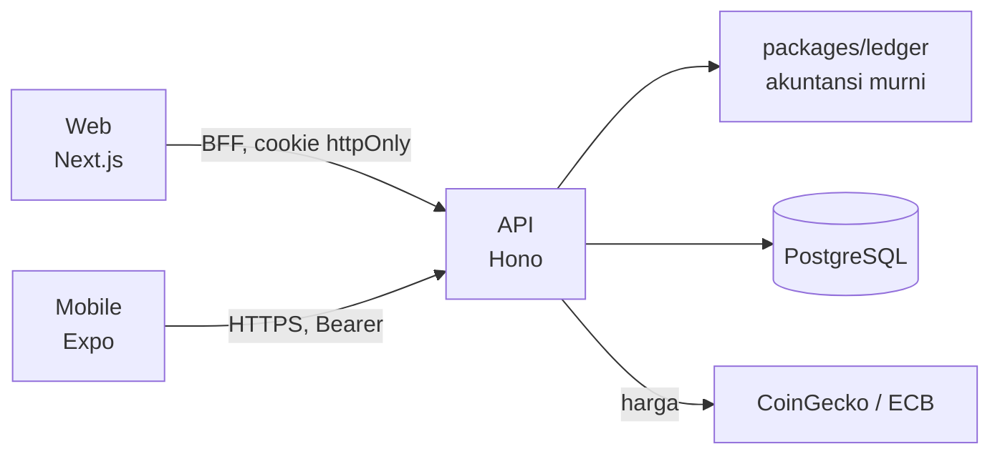

## Struktur repo

```
apps/api              REST API (Hono)
apps/web              Web (Next.js)
apps/mobile           Android + iOS (Expo)
packages/ledger       Inti akuntansi murni: jurnal, pembatalan, modal rata-rata
packages/db           Skema Drizzle dan migrasi
packages/validation   Skema Zod bersama
packages/api-client   Klien HTTP, tipe, format angka, katalog logo (web dan mobile)
deploy/               Dockerfile, Compose, skrip deploy/backup/restore, nginx
docs/                 Panduan deploy, catatan teknis, migrasi FinMap
design/dashboard      Mockup desain "Batik Sogan"
```

## Mulai cepat

Butuh **Node 22+**, **pnpm 12**, dan **Docker** (hanya untuk menjalankan PostgreSQL lokal; boleh diganti Postgres Anda sendiri).

```bash
pnpm install
cp .env.example .env
pnpm db:up          # PostgreSQL via Docker (port 5434)
pnpm db:migrate
pnpm db:seed        # katalog aset (kripto, emas, valas)
pnpm dev:api        # http://localhost:4000/api/health
pnpm dev:web        # http://localhost:3000
pnpm dev:mobile     # Expo: pindai QR dengan Expo Go, atau tekan a / i
```

Buka http://localhost:3000, daftar, lalu ikuti panduan **Mulai cepat** di Beranda.

> Untuk pengembangan, `MARKET_PROVIDER=fake` memakai harga tiruan tanpa internet. Untuk data nyata biarkan `coingecko`.

### Perintah

| Perintah | Fungsi |
| --- | --- |
| `pnpm typecheck` | Periksa tipe seluruh paket |
| `pnpm test` | Tes unit (187 tes) |
| `pnpm test:integration` | Tes integrasi (120 tes, butuh PostgreSQL) |
| `pnpm db:generate` | Buat migrasi baru dari perubahan skema |
| `pnpm db:up` / `pnpm db:down` | Nyalakan / matikan PostgreSQL lokal |

### Konfigurasi

Salin `.env.example` ke `.env`. Yang paling penting:

| Variabel | Keterangan |
| --- | --- |
| `DATABASE_URL` | Koneksi PostgreSQL |
| `JWT_SECRET` | Rahasia penandatangan token, minimal 32 karakter |
| `WEB_ORIGIN` | Alamat web (boleh beberapa, dipisah koma) untuk CORS |
| `MARKET_PROVIDER` | `coingecko` untuk harga nyata, `fake` hanya untuk dev/tes |
| `MAIL_TRANSPORT` / `SMTP_URL` | Email "lupa kata sandi": `console` untuk dev, **`smtp` wajib di produksi** |
| `EXPO_PUBLIC_API_URL` | Alamat API untuk mobile (IP LAN di perangkat fisik; rilis wajib HTTPS) |

## Deploy

Bandha disiapkan untuk dua lingkungan dari dua branch: `development` dan `main`, masing-masing dengan Docker Compose sendiri (database, migrasi otomatis, API, web). Skrip `deploy/deploy.sh` menarik kode, membangun, menunggu semua layanan sehat, dan **otomatis memulihkan versi sebelumnya** bila versi baru gagal. CI/CD berjalan lewat GitHub Actions.

Panduan lengkap, termasuk pengaturan database, backup/restore, nginx, dan daftar keamanan: **[docs/DEPLOY.md](docs/DEPLOY.md)**.

## Keamanan

- Kata sandi di-hash dengan argon2; token reset berumur pendek, sekali pakai, dan disimpan sebagai hash.
- Web memakai cookie `httpOnly`/`Secure`; mobile memakai SecureStore. Token tidak pernah dapat dibaca JavaScript halaman.
- Rahasia, kunci, dan dump database tidak pernah masuk git (`.gitignore` diaudit); `deploy/.env` hanya ada di server.
- Port layanan terikat ke `127.0.0.1`; hanya nginx yang terbuka ke publik.

Menemukan celah? Mohon laporkan secara pribadi kepada pemilik repositori, jangan lewat *issue* publik.

## Batasan dan rencana

- Mata uang asing terbatas pada 30 mata uang ECB (belum SAR, AED, VND, dll.).
- Utang/piutang hanya IDR dan belum punya jadwal cicilan/bunga otomatis. Beli/jual aset lawan aset (mis. BTC dengan USDT) sudah ada di web dan di aplikasi mobile.
- Belum ada: harga emas dari sumber khusus, halaman detail aset, ikon dan splash final, build rilis mobile (EAS), serta tes UI web/mobile.
- Aplikasi mobile belum dibangun menjadi APK/IPA; saat ini dijalankan lewat Expo.

## Lisensi

Belum ditentukan. Sampai lisensi ditambahkan, semua hak dipegang pemilik repositori.
